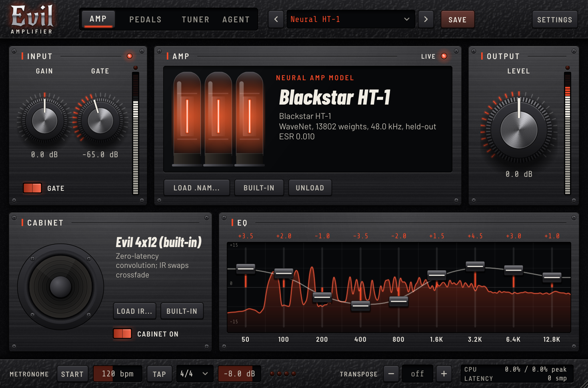

# Evil Amplifier

A real-time guitar amp simulator plugin (VST3, AU, standalone) that runs a neural network
trained on recordings of a real amp. C++/JUCE for the real-time half, PyTorch for the offline
half. It ships with a model of a **Blackstar HT-1 tube amp** trained by this project's
trainer, and it loads any [Neural Amp Modeler](https://www.neuralampmodeler.com) `.nam` file.



```
guitar ─► input gain ─► noise gate ─► transposer ─► compressor ─► fuzz ─► overdrive ─┐
                                                                                     │
  ┌──────────────────────────────────────────────────────────────────────────────────┘
  └─► AMP: NAM model ──────────────► cab IR ─► 9-band EQ ─► chorus ─► delay ─► reverb ─► output
      at its trained rate (band-limited                                      (+ metronome)
      resampling if the host differs)
```

## Measured results

All numbers are from this repository on an i7-11700F (Linux, release build) and are
reproducible with the commands shown.

| Criterion (from the brief) | Target | Result |
|---|---|---|
| Host compatibility | pluginval strictness ≥ 5 | **Passes strictness 10**, all 25 test groups (VST3, Linux) |
| CPU cost, 128 samples @ 48 kHz | < 25% of the deadline | **7.7% mean, 10.7% p99** for the full chain with the standard WaveNet (`evil-cli bench`) |
| ... at 44.1 kHz host (resampled) | | 9.1% mean, 13.6% p99 |
| Real-time stability | 0 dropouts in 30 min | 30 simulated minutes: **0 of 675,000 blocks over deadline**, worst block 26% (see [stability](#stability)) |
| Nothing allocates on the audio thread | | **0 allocations, 0 frees** over 6,000 blocks with live model, IR and pedal swaps (malloc interposed) |
| Model accuracy (held-out ESR) | reported per capture | Blackstar HT-1: **0.0101** on 60 s never trained on (validation 0.0072) |
| C++ matches PyTorch | | Same model in NAM Core: **0.010117** vs PyTorch **0.010117** held-out ESR; parity test max error 4.8e-7 |
| Latency | reported to host | 0 samples at the model's own rate, 73 (1.7 ms) at 44.1 kHz |

The brief also asks for blind A/B tests against the real amp. That needs listeners:
`training/runs/ht1/renders/` (made by the trainer) holds the held-out DI, the real amp's
recording and the model's prediction for exactly that.

## Install

Download the zip for your OS from the [Releases page](https://github.com/bnamayandev/map-modeler/releases)
(no GitHub account needed), or build it (below). Each zip has an `INSTALL.txt`. Then copy the
plugin where your DAW looks:

| OS | VST3 | AU | Standalone |
|---|---|---|---|
| macOS | `~/Library/Audio/Plug-Ins/VST3/` | `~/Library/Audio/Plug-Ins/Components/` | `Evil Amplifier.app` anywhere |
| Windows | `C:\Program Files\Common Files\VST3\` | n/a | `Evil Amplifier.exe` anywhere |
| Linux | `~/.vst3/` | n/a | `Evil Amplifier` anywhere |

- **Linux**: after building, `scripts/install-linux.sh` installs the VST3 to `~/.vst3`, the
  standalone to `~/.local/bin/evil-amplifier` and an app-menu launcher (`--uninstall` removes them).
- **macOS**: CI builds are not code-signed. After copying, run
  `xattr -dr com.apple.quarantine "~/Library/Audio/Plug-Ins/VST3/Evil Amplifier.vst3"` (and the
  same for the `.component` / `.app`), otherwise Gatekeeper blocks them.
- **Standalone**: JUCE starts with the input muted (to avoid feedback through laptop
  speakers) and shows a yellow banner. Click its **Settings...** button, pick your interface,
  set the buffer to 128 samples, enable the input your guitar is plugged into, and untick
  **Mute audio input**. Use headphones or monitors, not laptop speakers next to a pickup.
- **Linux standalone on PipeWire**: pick **JACK** in Settings (no `pw-jack` needed). Its sample
  rate and buffer size menus set PipeWire's graph while the app runs, and PipeWire goes back to
  its defaults when the app quits. Round-trip delay on a USB interface is about 4x the buffer:
  64 samples at 48 kHz is ~5 ms, PipeWire's default 1024 is ~85 ms.

## Playing it

- **Input** drives the amp (a NAM model expects roughly instrument level; turn up if your
  interface gain is low). **Gate** is the threshold; the LED is green when it's open.
- **Amp**: runs the loaded `.nam` model as it is, with nothing added and no level
  adjustment. Models differ in loudness, so set **Output** to taste.
  - **Load .nam...** loads any NAM model (WaveNet, LSTM, A2, ... from ToneHunt/TONE3000, the
    official trainer, or `training/`). Loading happens off the audio thread and the switch
    crossfades over 40 ms. The panel shows the model's held-out ESR if its metadata has it.
  - **Unload** plays with no model: the amp passes clean.
- **Cabinet**: built-in synthetic 4x12, shaped after real SM57 IRs, or **Load IR...** (WAV/AIFF/FLAC,
  any rate, mono or first channel of stereo, up to 2 s). A real IR will always be better than the
  built-in one. IRs are energy-normalised and swap without clicks.
  Turn it off for models that already include a cab (mic'd captures).
- **EQ**: nine-band graphic EQ, octave bands from 50 Hz to 12.8 kHz (a Boss GE-7's seven plus
  one at each end), ±15 dB each. A fader's number is exactly the change in dB at its band, however
  its neighbours are set: the filters allow for how they overlap, where a plain graphic EQ would
  give +8.7 dB for five faders at +6. The faders have a parabolic taper, fine around 0 dB, over a
  live spectrum of the output.
  Presets and sessions saved with the old bass/mid/treble EQ load with the nearest
  band settings.
- **Pedals** (the *pedals* tab; its label counts the pedals that are on): two rows in signal
  order. Wah, compressor, fuzz, overdrive, distortion and boost go before the amp; phaser,
  flanger, chorus, tremolo, delay and reverb after the cab, like an effects loop.
  Click a footswitch to turn a pedal on; switching crossfades over 10 ms, and a pedal that's
  off is skipped entirely (bit-exact pass-through, no CPU).

  Each slot is modelled on one standard pedal, and a knob's pointer sits where that pedal's would:
  noon here is noon on the real thing. See [the reference pedals](#the-reference-pedals).
  - *Wah*: Cry Baby. Pedal (heel to toe, 350 Hz to 2.2 kHz; automate it or map an expression pedal
    in your host), Peak (noon is stock), and Auto, not on the original (an envelope follower opens
    the filter as you pick harder, up to a full envelope filter).
  - *Compressor*: Dyna Comp. Sens, Output, and Blend, not on the original (full up is the original).
  - *Fuzz*: Big Muff Pi. Sustain, Tone (scoops the mids at noon, dark and wooly below, cutting
    above), Volume.
  - *Overdrive*: Tube Screamer. Drive, Tone, Level. Thins the lows and pushes the mids, even with
    Drive at 0. Low drive and high level tightens a dirty amp; on a clean amp it's a crunch tone.
  - *Distortion*: ProCo RAT. Dist (nearly clean when down, heavy from noon up, smoother as it goes),
    Filter (as on a real one, darker clockwise), Volume.
  - *Boost*: Micro Amp. Gain (0 to +26 dB), and Bass and Treble, not on the original (flat at noon).
  - *Phaser*: Phase 90. Speed, and Depth and Feedback, not on the original.
    *Flanger*: M117. Speed, Width, Regen. *Chorus*: CE-2. Rate, Depth, and Mix, not on the original
    (noon is the original). *Tremolo*: TR-2. Rate, Depth, Wave (triangle to square).
    *Delay*: Carbon Copy. 20 ms to 2 s, past the original's 600 ms; repeats get darker the longer
    the delay. *Reverb*: Dattorro plate. Delay and reverb add their wet signal on top of an
    unchanged dry signal.
  - All twelve pedals and the transposer together add ~7% of the block deadline
    (`evil-cli bench --pedals all --transpose -2`), most of it the three drive pedals: about
    1.6% for the overdrive, 0.8% for the distortion and 3% for the fuzz.
- **Tuner** (the *tuner* tab): pick a built-in tuning, or set any string to any note. String 1
  is the thinnest. Picking a note name takes the octave closest to that string's usual pitch,
  so string 1 to D is D4 and string 4 to Gb is Gb3; **-** and **+** move it an octave.
  - **Save** keeps the notes under a name, in `tunings.xml` in `~/.config/EvilAmplifier/` (Linux),
    `~/Library/EvilAmplifier/` (macOS) or `%APPDATA%\EvilAmplifier\` (Windows). Presets and
    sessions don't change your tuning or your saved tunings.
  - It works out which string you're playing. If a string is too far off for that, click its
    number to lock onto it: the meter then says how far to go, in semitones if need be.
  - It hears the guitar itself, before the input gain, gate and transposer, and keeps working
    while the plugin is bypassed. Your sound isn't muted while you tune.
- **Agent** (the *agent* tab): tell it the sound you're after, and an AI model on your own API
  key looks up the gear and sets up the amp. See [the agent](#the-agent).
- **Transpose** (bottom right): ±12 semitones, e.g. -1 for E-flat tuning. Polyphonic, with
  splices aligned to the waveform; it costs ~16 ms of delay while on, and 0 ("off") bypasses
  it completely.
- **Metronome** (bottom left): start/stop, tempo (drag, or double-click to type), **tap**
  (each tap also restarts the bar), beats per bar (beat one clicks higher) and level. The
  click is mixed into the output. It always starts stopped.
- **Presets**: nine factory presets (also exposed as host programs). **Save** writes user
  presets to `~/.config/EvilAmplifier/Presets` (Linux), `~/Library/EvilAmplifier/Presets`
  (macOS) or `%APPDATA%\EvilAmplifier\Presets` (Windows). Presets
  include the pedals but not the transposer or metronome settings, which stay as you set them.
- **Log**: model loads, latency changes and CPU per block (every 30 s while playing) go to
  `EvilAmplifier.log` in `~/.config/EvilAmplifier/` (Linux), `~/Library/Logs/EvilAmplifier/`
  (macOS) or `%APPDATA%\EvilAmplifier\` (Windows).
- The editor is resizable (fixed aspect ratio, 60% to 200%).

## The agent

A chat that researches tones and sets up the amp. Name a song or an artist and your guitar, and it
searches for the gear on the record, finds captures of that gear on
[TONE3000](https://www.tone3000.com), loads them, sets the pedals and EQ, and allows for your
pickups. Then "make it creamier" or "add a fuzz" adjusts what's there. Everything it does is
listed as it happens, and **revert to before this** undoes a whole answer. No tones are stored in
it: everything about a song comes from what it finds at the time.

If a song's sound changes between parts, the pedals for later parts are left off with their knobs
already set, and its answer ends with a plan of what to stomp on when.

It can't hear, so it measures: **measure_tone** plays a test guitar through a private copy of the amp
and reports the spectrum, distortion and touch response (how much louder it gets when picked 12 dB
harder), against the capture alone. `evil-cli measure` shows the same reading for any setup. It
takes knob positions as a guide gives them, by clock or 0-10, and starts each new tone by clearing
what the last one left.

**Setup.** Under **keys**, paste an API key for any of these. You pay the provider directly, and
requests go straight from your computer to them.

| | Default model | Other suggestions | Its web search |
|---|---|---|---|
| Claude | `claude-opus-5-5` | `claude-sonnet-5-5`, `claude-haiku-5-5` | Anthropic's web search tool |
| ChatGPT | `gpt-6.1-sol` | `gpt-6-astra`, `gpt-6.1-terra`, `gpt-6-luna` | OpenAI's web search tool |
| Gemini | `gemini-3.8-flash` | `gemini-4-argon`, `gemini-3.6-flash`, `gemini-3.5-flash-lite` | Grounding with Google Search |

The model box takes any name, for when these lists date. Searches can cost extra, beyond the
tokens shown after each answer, and stop after 15 for each message. A message about a song can
take a lot of tokens (about 200k in testing), as the research all goes back through the model.

For captures, also paste your TONE3000 *publishable* key (`t3k_pub_...`, from
[your settings](https://www.tone3000.com/settings)), click **sign in**, and enter the code it shows
at tone3000.com/activate, on your phone or any browser. That's the only time: the amp refreshes its
sign-in from then on, and no browser has to stay open. Without it the agent still works, with the
built-in capture and the pedals. If the agent needs TONE3000 and you're not signed in, it shows the
code in the chat and waits two minutes, once, then carries on without.

**How it finds captures.** TONE3000's free tier, which an open-source amp falls under, allows its
sign-in flows and bounded lists but not its search endpoint. So the agent finds tone pages with its
own web search and fetches those tones by ID, which is the pattern TONE3000's Load Tone example
uses. **browse tone3000** opens the full catalog for picking one yourself, and it's the only thing
that opens your browser. Files download to
`Tone3000/` beside your presets, only when asked for, and stay credited to their creators on the
amp page. Presets that use them keep working offline.

**What it can do.** Only this: set the controls, load a built-in, read TONE3000 tones and load
their files, all by ID. It has no general web fetch and no file access, and what it reads on the web
is treated as untrusted, so the worst a bad page can do is a bad tone you can revert. It can't touch
the transposer or metronome. The sign-in token only goes to TONE3000 over https. Links in the chat
open only if they're http or https.

**Level.** A NAM capture can be far louder than the last one, so the output is pulled down before a
swap and set from the two captures' loudness figures after it (6 dB under where it was if a capture
has no figure). The agent can raise the output by at most 6 dB at a time, up to +6 dB, and the input
to +12 dB. These are enforced by the amp, not by asking the model.

**Your keys** are kept in `agent.xml` beside your presets, readable only by your user. That's a
plain file, not the OS keychain. They're never in presets, sessions or the log.

**Limits.** There's one neural slot and it's the amp, so a capture of a pedal can't sit in front of
it: the agent uses the closest built-in pedal and says so. Replies appear when finished rather than
word by word. Google's terms want its Search Suggestions shown with grounded answers; they arrive as
HTML and this build has no web view, so they're shown as ordinary links.

**Without a window:** `evil-cli agent "Make it creamier"` runs the same agent on a headless copy of
the amp and prints what it did. It takes keys from `ANTHROPIC_API_KEY`, `OPENAI_API_KEY`,
`GEMINI_API_KEY` and `TONE3000_PUBLISHABLE_KEY`, and doesn't save them. It shares the amp's
TONE3000 sign-in: `evil-cli tone3000 connect` signs in by code from a terminal, even over SSH, and
`evil-cli tone3000 status` checks it still works.

## Build

Requirements: CMake ≥ 3.24, a C++20 compiler (Xcode 14+, Visual Studio 2022, GCC 11+ or Clang
14+), Ninja recommended. Dependencies (JUCE 8.0.15, NeuralAmpModelerCore v0.6.0, Eigen,
Catch2) are fetched at configure time, pinned to exact versions.

```bash
# Linux only: sudo apt install ninja-build libasound2-dev libfreetype-dev libfontconfig1-dev \
#   libx11-dev libxcomposite-dev libxcursor-dev libxext-dev libxinerama-dev libxrandr-dev libxrender-dev libgl1-mesa-dev \
#   libcurl4-openssl-dev \  # JUCE's only HTTPS on Linux, for the agent
#   libjack-jackd2-dev pipewire-jack   # optional: JACK support in the standalone
cmake -S . -B build -G Ninja -DCMAKE_BUILD_TYPE=Release
cmake --build build
```

Windows builds include ASIO in the standalone's audio settings, using the ASIO SDK headers
that ship with JUCE. Pick ASIO there for the full range of sample rates and buffer sizes your
interface supports; plain "Windows Audio" only offers the system mixer's single rate and size.

Outputs land in `build/EvilAmplifier_artefacts/Release/{VST3,AU,Standalone}/`. Add
`-DEVIL_COPY_PLUGIN_AFTER_BUILD=ON` to install into your user plugin folders on every build.
On macOS add `"-DCMAKE_OSX_ARCHITECTURES=arm64;x86_64"` for a universal binary. Always build
Release to play: Eigen in a debug build is far too slow for real time.

To publish a release: `git tag v0.1.0 && git push origin v0.1.0`. CI builds all three
platforms and attaches `EvilAmplifier-{Windows,macOS,Linux}.zip` to a GitHub release.

CI (`.github/workflows/ci.yml`) builds Linux, macOS (universal; VST3, AU, Standalone) and
Windows on every push, runs the tests and pluginval at strictness 10 (VST3 everywhere, AU on
macOS), reports CPU benchmarks, renders a GUI screenshot and uploads installable artifacts.
It also smoke-tests the training pipeline end to end.

## Test and measure

```bash
build/tests/evil_tests_artefacts/Release/evil_tests          # 123 test cases
pluginval --strictness-level 10 --validate-in-process "build/EvilAmplifier_artefacts/Release/VST3/Evil Amplifier.vst3"

cli=build/evil-cli_artefacts/Release/evil-cli
$cli bench --seconds 60 --block 128 --rate 48000              # CPU per block vs deadline (--csv for every block)
$cli esr test-in.wav test-target.wav --model my.nam            # held-out ESR through the plugin's C++ path
$cli render guitar.wav out.wav --model my.nam --ir cab.wav     # offline render, latency compensated
$cli render guitar.wav out.wav --no-model --no-cab --pedals od --set od_drive=0.3,od_tone=0.6  # any knob, by id
$cli info my.nam
$cli agent "Make it creamier" --provider anthropic             # the agent, with no window
build/evil-snapshot_artefacts/Release/evil-snapshot shots/     # render the GUI to PNG, no window needed
```

The tests cover:

- **Parity**: a model exported by the PyTorch trainer reproduces PyTorch's output in NAM Core
  (ESR 1.6e-14). This is the check that the exporter's weight layout is right.
- **Published models**: every example model shipped with NAM Core (WaveNet A1/A2, LSTM,
  slimmable, container) loads and runs; corrupt files fail with a message.
- **Real-time safety**: heap allocations and frees on the audio thread are counted while
  models, IRs and pedals change underneath. The required count is zero.
- **Resampling**: in-band accuracy better than -60 dB, more than 60 dB rejection of content
  that would alias, block-size independence, and an identity model coming out delayed by
  exactly the reported latency at 44.1/48/96 kHz.
- **DSP**: bit-exact pass-through with everything neutral, gate hysteresis and hold, EQ band
  gains, IR swaps without discontinuities.
- **Drive pedals**: all three against numbers measured from captures of the real pedals (the captures
  themselves aren't in this repository), aliasing, and the same sound at any sample rate.
- **Knobs and EQ**: pointers where the real pedals' would be, and every EQ fader giving its stated
  dB at its band, in any combination.
- **Tuner**: pitch within a cent from E1 to E6 at 44.1 to 192 kHz, plucked strings without
  octave errors even with a weak fundamental, silence on hum and noise; note and tuning
  parsing, picking the octave, and saved tunings surviving a reload or a damaged file.
- **Agent**: each provider's requests and replies, built from its documentation (no key needed):
  signed thinking kept verbatim, resuming paused searches, retries, and a real bad-key error
  captured from Google. Sign-in by code without opening anything, staying signed in across restarts
  and other copies of the amp, the catalog over a real loopback socket with PKCE and a forged redirect
  refused, the HTTP client over a real local socket, downloads refusing unsafe URLs and names, the
  level limits, revert, and closing the plugin mid-request without a deadlock.
- **CPU budget**: the chain stays under 25% of the deadline (skipped on CI runners, where
  timing is noisy).

### Stability

`evil-cli bench --seconds 1800` runs 30 minutes of guitar-like signal through the full chain
in 128-sample blocks and records every block's time against its 2.67 ms deadline. Result:
mean 7.4%, p99 8.7%, p99.9 12.6%, worst block 26.3%, **0 of 675,000 blocks late**. This
measures compute headroom. It can't stand in for 30 minutes of playing through a real audio
interface (driver and OS scheduling), so that remains a manual check: play for 30 minutes at
128 samples and confirm the log shows `0 overruns`.

## Training your own capture

See [`training/README.md`](training/README.md). In short:

```bash
cd training && pip install -r requirements.txt
python -m evilamp.capture_signal capture/ --di my_guitar_di.wav    # reamp signal + latency blips + held-out region
#   ...play capture/capture_input.wav through a reamp box into the amp, record its output at 48 kHz...
python -m evilamp.train --capture-meta capture/capture.json --capture-output recorded.wav \
    --delay auto --arch standard --out my_amp.nam --renders renders/
```

It prints the latency found from the blips, then validation and held-out test ESR, and writes
the ESR into the model's metadata. `scripts/train_ht1.sh` reproduces the bundled model
(20 minutes on an RTX 3070).

## How it works

**Two halves.** `training/` (Python) turns input/output recordings into a `.nam` file: a
NAM-compatible WaveNet in PyTorch, exported in NAM Core's exact weight order. `source/` (C++)
runs it: `SignalChain` is the whole DSP path, independent of the plugin wrapper, so the
tests and CLI run exactly what the plugin runs.

**Real-time rules.** The audio thread never allocates, locks, or does I/O:

- Models load on a worker thread: parse, build, prepare and prewarm there. The finished model
  is handed over through one atomic pointer. The audio thread swaps it in at a block
  boundary and crossfades, and sends the old one back through a lock-free FIFO to be
  deleted on the message thread.
- IRs are read, checked and normalised off the audio thread. `juce::dsp::Convolution` swaps
  them in with its own crossfade.
- Every buffer is sized in `prepareToPlay`. Blocks bigger than announced are split.
  Coefficients are computed with plain arithmetic (`juce::dsp::IIR::Coefficients` allocates).
- After `prepareToPlay`, every stage starts at the first block's settings instead of gliding
  from defaults. Later changes are smoothed or crossfaded.
- Latency changes are reported to the host from the message thread. Bypass delays the dry
  signal by the same amount, so engaging it doesn't shift timing.

**Sample rates.** A NAM model only sounds right at the rate it was trained at: its filters
and dilations are counted in samples, so a 48 kHz model run at 44.1 kHz shifts every
resonance down 9%. When the host rate differs, the model runs inside a pair of band-limited
streaming resamplers (Kaiser-windowed sinc, exact rational phase, cutoff below the lower
Nyquist). A FIFO of computed size guarantees exactly one output sample per input sample.

### Drive pedals

The overdrive, distortion and fuzz run in volts, with the circuits' component values. Digital full
scale is +12 dBu peak (4.37 V), a common level for reamping NAM captures, so a pedal hits a NAM
amp about as hard as the real one would (if your interface is calibrated like that; **Input** trims
the difference). Each clips with the real 1N4148 diode equation, solved per sample, and pots follow
audio tapers. Clipping this hard makes a near-square wave, so all of it runs at 4x (less at higher
host rates) with first-order antiderivative anti-aliasing on top. The filters barely delay the
signal, about 5 samples, and that isn't reported to the host.

| | Tube Screamer | ProCo RAT | Big Muff Pi |
|---|---|---|---|
| Gain | 12 to 118x above 720 Hz, unity below (51k + 500k A over 4.7k + 47 nF) | Unity to 260x at 100 Hz, set by 100k A over 560R + 4.7 uF and 47R + 2.2 uF, limited by the LM308's 316 kHz gain-bandwidth | 12x, Sustain pot, then two stages of up to 47x with 470k and 470 pF |
| Clipping | Diodes in the op-amp's feedback, the clean signal on top | Diodes to ground behind 1k | Diodes in both stages' feedback |
| Tone | 723 Hz low-pass and the 20k active treble control, from nodal analysis | 1.5k + 100k A into 3.3 nF: 32 kHz to 475 Hz | 39k + 10 nF and 22k + 3.9 nF through a 100k pot |

The overdrive is checked against [public NAM captures](https://github.com/pelennor2170/NAM_models)
of a real Ibanez Tube Screamer Mini, a close relative of the classic circuit
(`tests/TestPedals.cpp` holds the measured numbers, not the captures). With its knobs at 5/5/5 it tracks the real pedal within 2 dB from 100 Hz to 8 kHz on a
real guitar DI through a real amp and cab, and its 1 kHz saturation curve fits within 1 dB from
0.003 to full scale. The S-shaped Tone law and the 3 V rail are fitted to those captures, and
the knob positions in their names are approximate.

The distortion is checked against captures from TONE3000 of a real ProCo RAT. Its Filter response
is within about 1 dB at noon, which is how its pot's curve was set, and the gain from Distortion down
to noon is within about 2 dB. The fuzz is checked against captures of a real NYC Big Muff. Its
transistors have an open-loop gain of about 30, not the ideal amplifiers they were first modelled
as, which fits both its response (within about 2.5 dB at the points tested, with bumps of up to 6 dB
around 3 to 6 kHz at some settings) and the change in gain with Sustain. How early it starts to clip
couldn't be fully checked, as that capture's input level isn't documented; it may still clip a little
early. The op-amp's slew limit and the transistors' own soft clipping aren't modelled.

### The reference pedals

Knob pointers follow these pedals' pots, so a setting for the real pedal goes straight across. Levels
are still stored in dB, so a saved level stays the same number of dB. Presets and sessions made
before these pedals and the EQ were corrected will sound different where they use them: most of all
the fuzz, which has much less gain, and EQ moves, which no longer overshoot. Host automation of a
level knob follows the new curve.

| Slot | Modelled on | Basis |
|---|---|---|
| Overdrive | Ibanez Tube Screamer | Circuit, checked against captures of a TS9 and a TS Mini. Level curve measured on both. |
| Distortion | ProCo RAT | Circuit, checked against captures. Volume curve estimated. |
| Fuzz | EHX Big Muff Pi (NYC) | Circuit, checked against captures. Volume curve estimated. |
| Boost | MXR Micro Amp | Its commonly quoted gain range, not checked against a source. Knob curve estimated. |
| Compressor | MXR Dyna Comp | Its behaviour, approximately. Not measured. |
| Wah | Dunlop Cry Baby GCB-95 | Dunlop's published sweep. Q curve approximate. |
| Phaser | MXR Phase 90 | Its four-stage recipe. Rates approximate. |
| Flanger | MXR M117 | Controls and character only. |
| Chorus | Boss CE-2 | Its recipe: one delay, triangle LFO, equal mix. Rates approximate. |
| Tremolo | Boss TR-2 | Published LFO range, triangle to square. |
| Delay | MXR Carbon Copy | Published time range, darker when longer. Darkening curve estimated. |
| Reverb | None in particular | A plate. |

**Deviations from the brief, and why:**

1. *No gray-box overdrive and no oversampling.* The amp is the NAM model alone, so nothing
   colours its sound. Oversampling the model itself would be wrong: running it at 2x or 4x
   its training rate changes what it computes, as above. A NAM model is trained against
   band-limited recordings at its own rate, which is also how the official NAM plugin runs
   them.
2. *The bundled capture is a real amp, but not one I recorded.* There's no reamp rig here,
   so the bundled model uses the published Blackstar HT-1 reamp dataset (see
   `LICENSES.md`). The full own-capture workflow (signal generation, blip latency
   detection, held-out split, training, export, C++ check) is implemented and was verified
   end to end with a simulated device: latency recovered to the sample, held-out ESR 0.0022.
   Recording your amp is the remaining hands-on step.
3. *NAM's fast tanh approximation is on* (as in the official NAM plugin). It is 2.5x faster
   and changes held-out ESR from 0.010117 to 0.010144.

## Layout

```
source/dsp/        SignalChain, ModelManager, NamModelRunner, StreamingResampler, CabSim,
                   Equaliser, NoiseGate, Biquad, Pedals, AnalogStages, ReverbPedal, PitchShifter,
                   PitchDetector, Metronome, DelayLine
source/state/      parameters, presets, tunings
source/gui/        look and feel, knobs, meters, pedal board, tuner page, agent page
source/agent/      the chat: LLM providers, tools and their limits, TONE3000, HTTPS, saved keys
source/            PluginProcessor, PluginEditor
resources/         bundled model (+ training report), synthetic cab IR, factory presets, TONE3000 logos
tests/             Catch2 suite, allocation tracker, parity data
tools/             evil-cli (render, esr, bench, info, agent, measure), evil-snapshot (offscreen GUI render)
training/          PyTorch trainer, capture signal generator, IR generator, golden-data generator
```

## Licences

See [`LICENSES.md`](LICENSES.md). Short version: JUCE is AGPLv3 or commercial, so binaries
you distribute are AGPLv3 unless you hold a JUCE licence. The bundled HT-1 model derives from
GPL-3.0 data.
