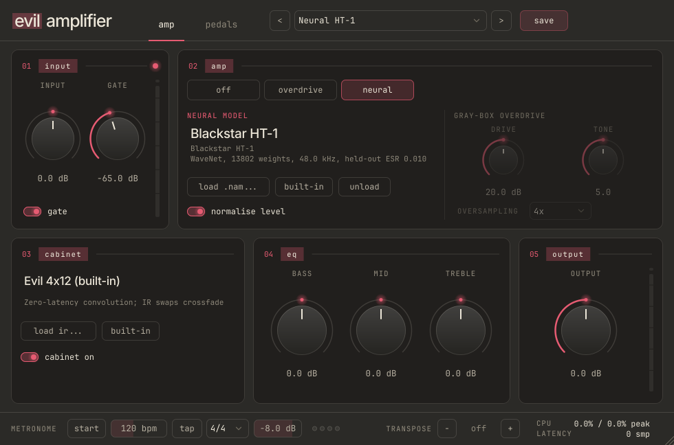

# Evil Amplifier

A real-time guitar amp simulator plugin (VST3, AU, standalone) that runs a neural network
trained on recordings of a real amp. C++/JUCE for the real-time half, PyTorch for the offline
half. It ships with a model of a **Blackstar HT-1 tube amp** trained by this project's
trainer, and it loads any [Neural Amp Modeler](https://www.neuralampmodeler.com) `.nam` file.



```
guitar ─► input gain ─► noise gate ─► transposer ─► compressor ─► fuzz ─► overdrive ─┐
                                                                                     │
  ┌──────────────────────────────────────────────────────────────────────────────────┘
  └─► AMP ─────────────────────────► cab IR ─► 9-band EQ ─► chorus ─► delay ─► reverb ─► output
      ├─ Neural: NAM model at its trained rate                                  (+ metronome)
      │  (band-limited resampling if the host differs)
      └─ Overdrive: drive ─► [2x/4x oversampled tanh] ─► tone
```

## Measured results

All numbers are from this repository on an i7-11700F (Linux, release build) and are
reproducible with the commands shown.

| Criterion (from the brief) | Target | Result |
|---|---|---|
| Host compatibility | pluginval strictness ≥ 5 | **Passes strictness 10**, all 25 test groups (VST3, Linux) |
| CPU cost, 128 samples @ 48 kHz | < 25% of the deadline | **7.7% mean, 10.7% p99** for the full chain with the standard WaveNet (`evil-cli bench`) |
| ... at 44.1 kHz host (resampled) | | 9.1% mean, 13.6% p99 |
| Real-time stability | 0 dropouts in 30 min | 30 simulated minutes: **0 of 675,000 blocks over deadline**, worst block 26% (see [stability](#stability)) |
| Nothing allocates on the audio thread | | **0 allocations, 0 frees** over 6,000 blocks with live model, IR, mode and oversampling swaps (malloc interposed) |
| Model accuracy (held-out ESR) | reported per capture | Blackstar HT-1: **0.0101** on 60 s never trained on (validation 0.0072) |
| C++ matches PyTorch | | Same model in NAM Core: **0.010117** vs PyTorch **0.010117** held-out ESR; parity test max error 4.8e-7 |
| Aliasing (overdrive, 3.1 kHz at 36 dB drive) | | inharmonic energy -19 dB (1x), -28 dB (2x), **-40 dB (4x)** |
| Latency | reported to host | Neural: 0 samples at the model's own rate, 73 (1.7 ms) at 44.1 kHz. Overdrive: 0 / 3 / 4 samples at 1x / 2x / 4x |

The brief also asks for blind A/B tests against the real amp. That needs listeners:
`training/runs/ht1/renders/` (made by the trainer) holds the held-out DI, the real amp's
recording and the model's prediction for exactly that.

## Install

Download the zip for your OS from the [Releases page](https://github.com/bnamayandev/map-modeler/releases)
(no GitHub account needed), or build it (below). Each zip has an `INSTALL.txt`. Then copy the
plugin where your DAW looks:

| OS | VST3 | AU | Standalone |
|---|---|---|---|
| macOS | `~/Library/Audio/Plug-Ins/VST3/` | `~/Library/Audio/Plug-Ins/Components/` | `Evil Amplifier.app` anywhere |
| Windows | `C:\Program Files\Common Files\VST3\` | n/a | `Evil Amplifier.exe` anywhere |
| Linux | `~/.vst3/` | n/a | `Evil Amplifier` anywhere |

- **Linux**: after building, `scripts/install-linux.sh` installs the VST3 to `~/.vst3`, the
  standalone to `~/.local/bin/evil-amplifier` and an app-menu launcher (`--uninstall` removes them).
- **macOS**: CI builds are not code-signed. After copying, run
  `xattr -dr com.apple.quarantine "~/Library/Audio/Plug-Ins/VST3/Evil Amplifier.vst3"` (and the
  same for the `.component` / `.app`), otherwise Gatekeeper blocks them.
- **Standalone**: JUCE starts with the input muted (to avoid feedback through laptop
  speakers) and shows a yellow banner. Click its **Settings...** button, pick your interface,
  set the buffer to 128 samples, enable the input your guitar is plugged into, and untick
  **Mute audio input**. Use headphones or monitors, not laptop speakers next to a pickup.
- **Linux standalone on PipeWire**: pick **JACK** in Settings (no `pw-jack` needed). Its sample
  rate and buffer size menus set PipeWire's graph while the app runs, and PipeWire goes back to
  its defaults when the app quits. Round-trip delay on a USB interface is about 4x the buffer:
  64 samples at 48 kHz is ~5 ms, PipeWire's default 1024 is ~85 ms.

## Playing it

- **Input** drives the amp (a NAM model expects roughly instrument level; turn up if your
  interface gain is low). **Gate** is the threshold; the LED is green when it's open.
- **Amp**: *Neural* runs the loaded `.nam` model; *Overdrive* is the gray-box waveshaper
  (Drive, Tone, oversampling Off/2x/4x); *Off* passes clean. Switching crossfades.
  - **Load .nam...** loads any NAM model (WaveNet, LSTM, A2, ... from ToneHunt/TONE3000, the
    official trainer, or `training/`). Loading happens off the audio thread and the switch
    crossfades over 40 ms. The panel shows the model's held-out ESR if its metadata has it.
  - **Normalise level** uses the model's loudness metadata to bring it to -18 dBFS so
    models are comparable.
- **Cabinet**: built-in synthetic 4x12, or **Load IR...** (WAV/AIFF/FLAC, any rate, mono or
  first channel of stereo, up to 2 s). IRs are energy-normalised and swap without clicks.
  Turn it off for models that already include a cab (mic'd captures).
- **EQ**: nine-band graphic EQ, octave bands from 50 Hz to 12.8 kHz, ±12 dB each.
  Presets and sessions saved with the old bass/mid/treble EQ load with the nearest
  band settings.
- **Pedals** (the *pedals* tab; its label counts the pedals that are on): two rows in signal
  order. Wah, compressor, fuzz, overdrive, distortion and boost go before the amp; phaser,
  flanger, chorus, tremolo, delay and reverb after the cab, like an effects loop.
  Click a footswitch to turn a pedal on; switching crossfades over 10 ms, and a pedal that's
  off is skipped entirely (bit-exact pass-through, no CPU).
  - *Wah*: Pedal (heel to toe, 350 Hz to 2.2 kHz; automate it or map an expression pedal in
    your host), Auto (an envelope follower opens the filter as you pick harder, up to a full
    envelope filter), Peak (resonance).
  - *Compressor*: Sustain (threshold and ratio together), Blend (parallel compression),
    Level. *Fuzz*: hard clipper with a scooped tone sweep. *Overdrive*: mid-hump screamer
    style; low drive and high level tightens the neural amp. *Distortion*: RAT-style op-amp
    clipper whose bandwidth narrows as the gain goes up, with a low-pass tone filter.
    *Boost*: clean gain (0 to +20 dB) with bass and treble shelves.
  - *Phaser*: four-stage, with feedback. *Flanger*: 0.7 to 7 ms sweep with feedback.
    *Chorus*: Rate, Depth, Mix. *Tremolo*: Rate, Depth and Shape (sine to square).
    *Delay*: 20 ms to 2 s; turning Time glides like a tape echo and repeats get darker.
    *Reverb*: Dattorro plate. Delay and reverb add their wet signal on top of an unchanged
    dry signal.
  - All twelve pedals and the transposer together add ~1.5% of the block deadline
    (`evil-cli bench --pedals all --transpose -2`).
- **Transpose** (bottom right): ±12 semitones, e.g. -1 for E-flat tuning. Polyphonic, with
  splices aligned to the waveform; it costs ~16 ms of delay while on, and 0 ("off") bypasses
  it completely.
- **Metronome** (bottom left): start/stop, tempo (drag, or double-click to type), **tap**
  (each tap also restarts the bar), beats per bar (beat one clicks higher) and level. The
  click is mixed into the output. It always starts stopped.
- **Presets**: nine factory presets (also exposed as host programs). **Save** writes user
  presets to `~/.config/EvilAmplifier/Presets` (Linux), `~/Library/EvilAmplifier/Presets`
  (macOS) or `%APPDATA%\EvilAmplifier\Presets` (Windows). Presets
  include the pedals but not the transposer or metronome settings, which stay as you set them.
- **Log**: model loads, latency changes and CPU per block (every 30 s while playing) go to
  `EvilAmplifier.log` in `~/.config/EvilAmplifier/` (Linux), `~/Library/Logs/EvilAmplifier/`
  (macOS) or `%APPDATA%\EvilAmplifier\` (Windows).
- The editor is resizable (fixed aspect ratio, 60% to 200%).

## Build

Requirements: CMake ≥ 3.24, a C++20 compiler (Xcode 14+, Visual Studio 2022, GCC 11+ or Clang
14+), Ninja recommended. Dependencies (JUCE 8.0.15, NeuralAmpModelerCore v0.6.0, Eigen,
Catch2) are fetched at configure time, pinned to exact versions.

```bash
# Linux only: sudo apt install ninja-build libasound2-dev libfreetype-dev libfontconfig1-dev \
#   libx11-dev libxcomposite-dev libxcursor-dev libxext-dev libxinerama-dev libxrandr-dev libxrender-dev libgl1-mesa-dev \
#   libjack-jackd2-dev pipewire-jack   # optional: JACK support in the standalone
cmake -S . -B build -G Ninja -DCMAKE_BUILD_TYPE=Release
cmake --build build
```

Windows builds include ASIO in the standalone's audio settings, using the ASIO SDK headers
that ship with JUCE. Pick ASIO there for the full range of sample rates and buffer sizes your
interface supports; plain "Windows Audio" only offers the system mixer's single rate and size.

Outputs land in `build/EvilAmplifier_artefacts/Release/{VST3,AU,Standalone}/`. Add
`-DEVIL_COPY_PLUGIN_AFTER_BUILD=ON` to install into your user plugin folders on every build.
On macOS add `"-DCMAKE_OSX_ARCHITECTURES=arm64;x86_64"` for a universal binary. Always build
Release to play: Eigen in a debug build is far too slow for real time.

To publish a release: `git tag v0.1.0 && git push origin v0.1.0`. CI builds all three
platforms and attaches `EvilAmplifier-{Windows,macOS,Linux}.zip` to a GitHub release.

CI (`.github/workflows/ci.yml`) builds Linux, macOS (universal; VST3, AU, Standalone) and
Windows on every push, runs the tests and pluginval at strictness 10 (VST3 everywhere, AU on
macOS), reports CPU benchmarks, renders a GUI screenshot and uploads installable artifacts.
It also smoke-tests the training pipeline end to end.

## Test and measure

```bash
build/tests/evil_tests_artefacts/Release/evil_tests          # 19 test cases
pluginval --strictness-level 10 --validate-in-process "build/EvilAmplifier_artefacts/Release/VST3/Evil Amplifier.vst3"

cli=build/evil-cli_artefacts/Release/evil-cli
$cli bench --seconds 60 --block 128 --rate 48000              # CPU per block vs deadline (--csv for every block)
$cli esr test-in.wav test-target.wav --model my.nam            # held-out ESR through the plugin's C++ path
$cli render guitar.wav out.wav --model my.nam --ir cab.wav     # offline render, latency compensated
$cli info my.nam
build/evil-snapshot_artefacts/Release/evil-snapshot shots/     # render the GUI to PNG, no window needed
```

The tests cover:

- **Parity**: a model exported by the PyTorch trainer reproduces PyTorch's output in NAM Core
  (ESR 1.6e-14). This is the check that the exporter's weight layout is right.
- **Published models**: every example model shipped with NAM Core (WaveNet A1/A2, LSTM,
  slimmable, container) loads and runs; corrupt files fail with a message.
- **Real-time safety**: heap allocations and frees on the audio thread are counted while
  models, IRs, amp modes and oversampling change underneath. The required count is zero.
- **Resampling**: in-band accuracy better than -60 dB, more than 60 dB rejection of content
  that would alias, block-size independence, and an identity model coming out delayed by
  exactly the reported latency at 44.1/48/96 kHz.
- **DSP**: bit-exact pass-through with everything neutral, gate hysteresis and hold, EQ band
  gains, oversampling reducing aliasing, IR swaps without discontinuities, mode switching.
- **CPU budget**: the chain stays under 25% of the deadline (skipped on CI runners, where
  timing is noisy).

### Stability

`evil-cli bench --seconds 1800` runs 30 minutes of guitar-like signal through the full chain
in 128-sample blocks and records every block's time against its 2.67 ms deadline. Result:
mean 7.4%, p99 8.7%, p99.9 12.6%, worst block 26.3%, **0 of 675,000 blocks late**. This
measures compute headroom. It can't stand in for 30 minutes of playing through a real audio
interface (driver and OS scheduling), so that remains a manual check: play for 30 minutes at
128 samples and confirm the log shows `0 overruns`.

## Training your own capture

See [`training/README.md`](training/README.md). In short:

```bash
cd training && pip install -r requirements.txt
python -m evilamp.capture_signal capture/ --di my_guitar_di.wav    # reamp signal + latency blips + held-out region
#   ...play capture/capture_input.wav through a reamp box into the amp, record its output at 48 kHz...
python -m evilamp.train --capture-meta capture/capture.json --capture-output recorded.wav \
    --delay auto --arch standard --out my_amp.nam --renders renders/
```

It prints the latency found from the blips, then validation and held-out test ESR, and writes
the ESR into the model's metadata. `scripts/train_ht1.sh` reproduces the bundled model
(20 minutes on an RTX 3070).

## How it works

**Two halves.** `training/` (Python) turns input/output recordings into a `.nam` file: a
NAM-compatible WaveNet in PyTorch, exported in NAM Core's exact weight order. `source/` (C++)
runs it: `SignalChain` is the whole DSP path, independent of the plugin wrapper, so the
tests and CLI run exactly what the plugin runs.

**Real-time rules.** The audio thread never allocates, locks, or does I/O:

- Models load on a worker thread: parse, build, prepare and prewarm there. The finished model
  is handed over through one atomic pointer. The audio thread swaps it in at a block
  boundary and crossfades, and sends the old one back through a lock-free FIFO to be
  deleted on the message thread.
- IRs are read, checked and normalised off the audio thread. `juce::dsp::Convolution` swaps
  them in with its own crossfade.
- Every buffer is sized in `prepareToPlay`. Blocks bigger than announced are split. All
  three oversamplers are built up front so switching factor never allocates. Coefficients
  are computed with plain arithmetic (`juce::dsp::IIR::Coefficients` allocates).
- After `prepareToPlay`, every stage starts at the first block's settings instead of gliding
  from defaults. Later changes are smoothed or crossfaded.
- Latency changes are reported to the host from the message thread. Bypass delays the dry
  signal by the same amount, so engaging it doesn't shift timing.

**Sample rates.** A NAM model only sounds right at the rate it was trained at: its filters
and dilations are counted in samples, so a 48 kHz model run at 44.1 kHz shifts every
resonance down 9%. When the host rate differs, the model runs inside a pair of band-limited
streaming resamplers (Kaiser-windowed sinc, exact rational phase, cutoff below the lower
Nyquist). A FIFO of computed size guarantees exactly one output sample per input sample.

**Deviations from the brief, and why:**

1. *Oversampling wraps the gray-box waveshaper, not the neural model.* Running a model at 2x
   or 4x its training rate changes what it computes, as above. A NAM model is trained
   against band-limited recordings at its own rate, which is also how the official NAM
   plugin runs them. The overdrive is oversampled (2x/4x, low-latency polyphase IIR) as
   specified.
2. *The bundled capture is a real amp, but not one I recorded.* There's no reamp rig here,
   so the bundled model uses the published Blackstar HT-1 reamp dataset (see
   `LICENSES.md`). The full own-capture workflow (signal generation, blip latency
   detection, held-out split, training, export, C++ check) is implemented and was verified
   end to end with a simulated device: latency recovered to the sample, held-out ESR 0.0022.
   Recording your amp is the remaining hands-on step.
3. *NAM's fast tanh approximation is on* (as in the official NAM plugin). It is 2.5x faster
   and changes held-out ESR from 0.010117 to 0.010144.

## Layout

```
source/dsp/        SignalChain, AmpStage, ModelManager, NamModelRunner, StreamingResampler,
                   Overdrive, CabSim, Equaliser, NoiseGate, Biquad, Pedals, ReverbPedal,
                   PitchShifter, Metronome, DelayLine
source/state/      parameters, presets
source/gui/        look and feel, knobs, meters, pedal board
source/            PluginProcessor, PluginEditor
resources/         bundled model (+ training report), synthetic cab IR, factory presets
tests/             Catch2 suite, allocation tracker, parity data
tools/             evil-cli (render, esr, bench, info), evil-snapshot (offscreen GUI render)
training/          PyTorch trainer, capture signal generator, IR generator, golden-data generator
```

## Licences

See [`LICENSES.md`](LICENSES.md). Short version: JUCE is AGPLv3 or commercial, so binaries
you distribute are AGPLv3 unless you hold a JUCE licence. The bundled HT-1 model derives from
GPL-3.0 data.
